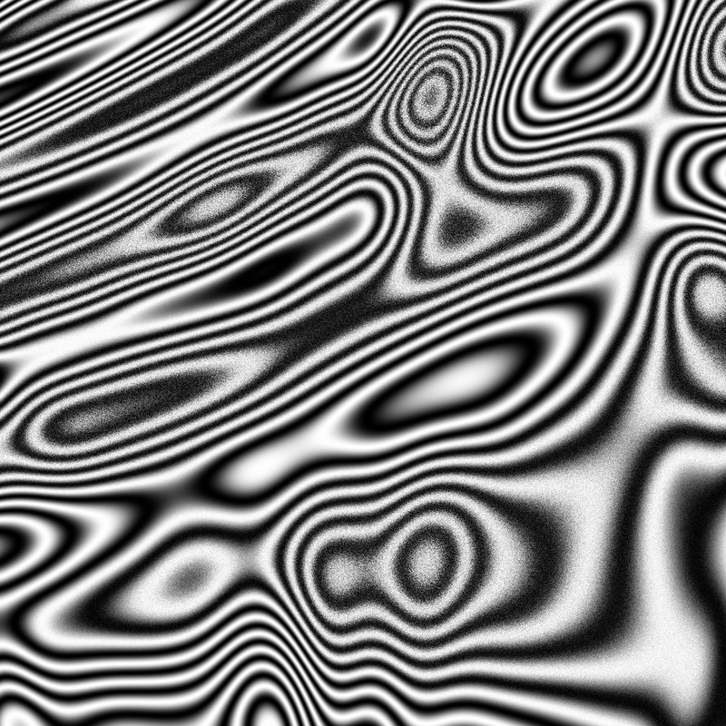
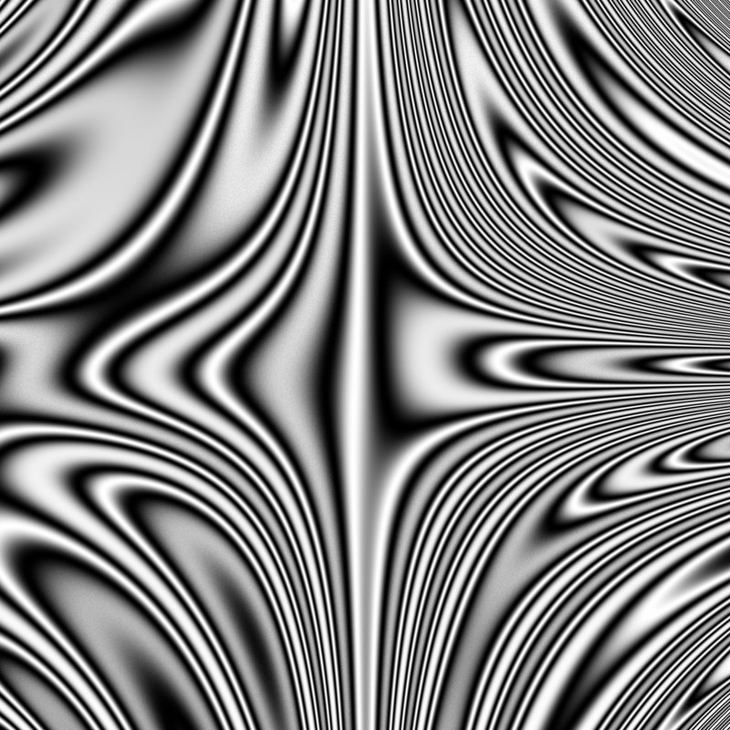
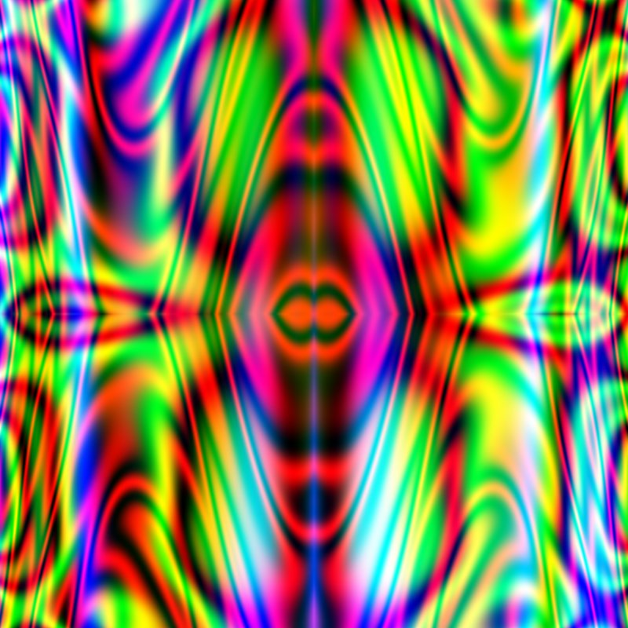
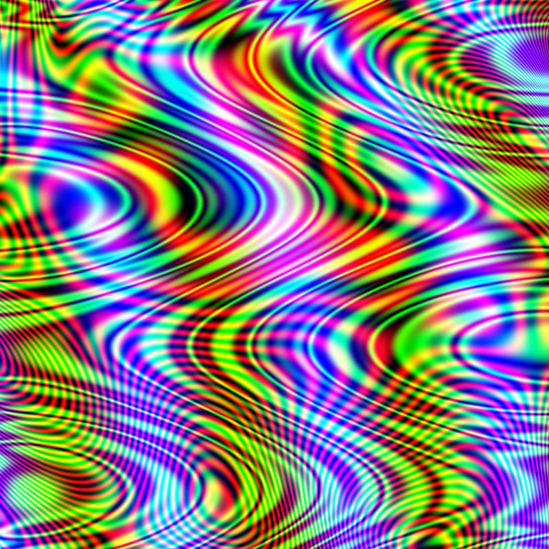

# Mingyo Random Art

Generative images built from random mathematical expressions.

Each image starts as a randomly grown expression tree of `x`, `y`, constants, `+ - *`, `sin` and `cos`.
The expression is evaluated for every pixel, then shaped with a gradient, an offset, soft `tanh` contrast
and a position-based noise texture. Gray images use one expression; color images use three, one per R, G and B channel.
Every expression is saved as a text file, so any image can be re-edited later from its own formula.

<p>
  
  
  
  
</p>

## Run it

You need Python 3.9 or newer.

```bash
git clone https://github.com/mingyoheo/mingyo-random-art.git
cd mingyo-random-art
pip install -r requirements.txt
python solution.py
```

No git? Click **Code → Download ZIP** on GitHub, unzip it, and run the last two commands inside that folder.

The script asks a few questions in the terminal:

1. **Make new images?** The first run always makes 5 gray and 5 color images.
2. **Re-edit images?** Re-renders every image from its saved expression with a new look. You choose a level from 4 to 8.
3. **Play images in mplay?** Plays the images as a sequence in Houdini's mplay. If Houdini isn't installed, just answer `n`.

Results are saved in a `RandomArt` folder next to the script:

```
RandomArt/
  images/   BW001.png ... COLOR001.png ...   (500 x 500)
  text/     BW001.txt ... COLOR001.txt ...   (the expression behind each image)
```

A gray image takes a few seconds; a color image can take 20 seconds or more, since every pixel is evaluated three times.

## Files

| File | What it does |
| --- | --- |
| `solution.py` | Main program: renders, saves and names images, then runs re-editing and mplay |
| `module/png.py` | Builds random expressions recursively (depth 4 to 8) |
| `module/readText.py` | Reads a saved expression file back as gray or color data |
| `module/reEdit.py` | Re-renders images from their saved expressions |
| `module/rename.py` | Renames output to `BW001`, `COLOR001`, ... |
| `module/mplay.py` | Finds Houdini's mplay on macOS, Windows or Linux and plays the sequence |

## Author

Mingyo Heo, 2025
